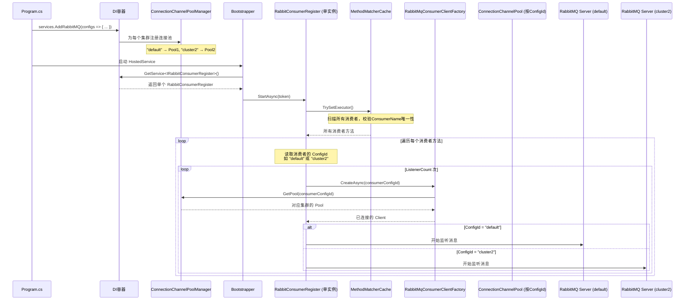
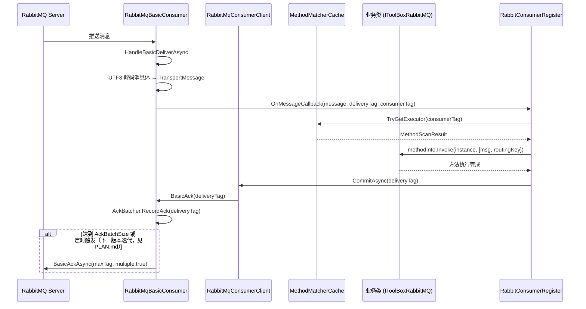
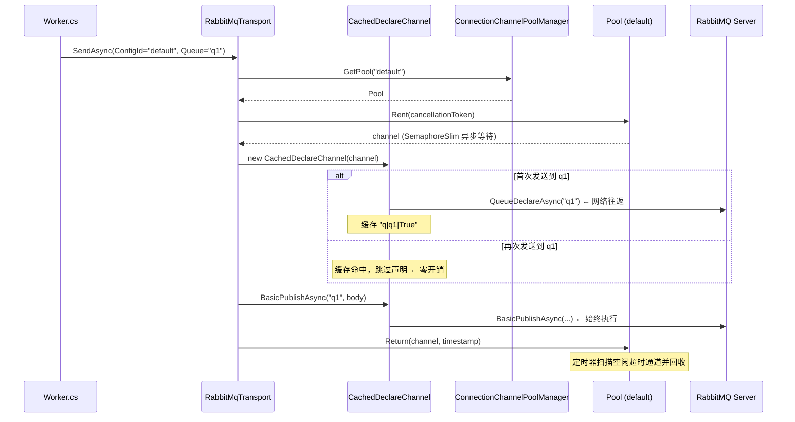
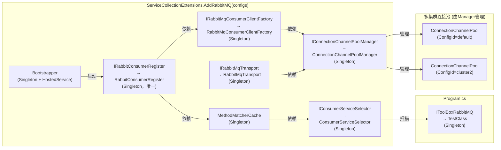

# H.ToolBox.RabbitMQ 项目架构文档

## 1. 项目概述

`H.ToolBox.RabbitMQ` 是一个基于 .NET 的 RabbitMQ 消费者/生产者工具库，采用 **特性标记 + 自动扫描** 的方式，简化 RabbitMQ 消费者的注册与管理。支持 **多集群** 连接，通过 `ConfigId` 区分不同集群，每个集群独立管理连接池，单个注册器统一管理所有集群的消费者。项目包含三个子项目：

| 子项目 | 用途 |
|---|---|
| `H.ToolBox.RabbitMQ` | 核心库，提供消费者注册、连接通道池管理、消息传输等功能，支持多集群 |
| `H.ToolBox.RabbitMQ.Application` | 示例应用，包含消费者业务逻辑实现 |
| `H.ToolBox.RabbitMQ.WorkerService` | 示例 Worker 服务，演示如何集成和使用核心库 |

---

## 2. 项目目录结构

```
H.ToolBox.RabbitMQ/
├── H.ToolBox.RabbitMQ.slnx                          # 解决方案文件
│
├── H.ToolBox.RabbitMQ/                               # 【核心库】
│   ├── Bootstrapper.cs                                # 后台启动器 (BackgroundService)
│   ├── IToolBoxRabbitMQ.cs                            # 消费者服务标记接口
│   ├── RabbitMQConsumerAttribute.cs                   # 消费者特性 (标记方法，含 ConfigId)
│   ├── ServiceCollectionExtensions.cs                 # DI 服务注册扩展方法 (支持多集群)
│   ├── TransportCheckProcessor.cs                     # 传输健康检查处理器（可配置间隔时间，<=0不开启）
│   │
│   ├── Channel/                                       # ── 连接通道池 ──
│   │   ├── IConnectionChannelPool.cs                  #   连接通道池接口
│   │   ├── ConnectionChannelPool.cs                   #   连接通道池实现 (SemaphoreSlim + 空闲回收)
│   │   ├── CachedDeclareChannel.cs                    #   声明缓存装饰器 (跳过重复 ExchangeDeclare/QueueDeclare)
│   │   ├── IConnectionChannelPoolManager.cs           #   连接通道池管理器接口 (多集群)
│   │   └── ConnectionChannelPoolManager.cs            #   连接通道池管理器实现 (多集群)
│   │
│   ├── Consumer/                                      # ── 消费者管理 ──
│   │   ├── IConsumerServiceSelector.cs                #   消费者服务选择器接口
│   │   ├── ConsumerServiceSelector.cs                 #   消费者服务选择器实现 (反射扫描)
│   │   ├── IRabbitConsumerRegister.cs                 #   消费者注册器接口
│   │   ├── RabbitConsumerRegister.cs                  #   消费者注册器实现 (单实例，按ConfigId路由)
│   │   ├── IRabbitMqConsumerClient.cs                 #   消费者客户端接口
│   │   ├── RabbitMqConsumerClient.cs                  #   消费者客户端实现 (消息监听)
│   │   ├── IRabbitMqConsumerClientFactory.cs          #   消费者客户端工厂接口 (支持 ConfigId)
│   │   ├── RabbitMqConsumerClientFactory.cs           #   消费者客户端工厂实现 (多集群)
│   │   ├── RabbitMqBasicConsumer.cs                   #   异步基础消费者 (Ack/Reject，接入 AckBatcher)
│   │   ├── AckBatcher.cs                              #   批量累积确认器 (维护连续 deliveryTag 区间，N条/定时混合触发)
│   │   ├── IConsumerService.cs                        #   消费者服务接口 (ListenAsync/ListenByExchangeAsync)
│   │   └── ConsumerService.cs                         #   消费者服务实现 (通过channelPool获取channel)
│   │
│   ├── Model/                                         # ── 数据模型 ──
│   │   ├── RabbitMQOptions.cs                         #   RabbitMQ 配置选项 (含 ConfigId)
│   │   ├── ListeningOptions.cs                        #   消费者监听选项
│   │   ├── MethodMatcherCache.cs                      #   方法匹配缓存 (支持按 ConfigId 过滤)
│   │   ├── MethodScanResult.cs                        #   方法扫描结果
│   │   ├── LogMessageEventArgs.cs                     #   日志事件参数
│   │   ├── MqLogType.cs                               #   日志类型枚举
│   │   ├── OperateResult.cs                           #   操作结果 (Success/Failed)
│   │   ├── PublisherSentFailedException.cs             #   发布失败异常
│   │   └── ExchangeTypeConst.cs                       #   交换机类型常量
│   │
│   └── Transport/                                     # ── 消息传输 ──
│       ├── IRabbitMqTransport.cs                      #   传输接口
│       ├── RabbitMqTransport.cs                       #   传输实现 (按 ConfigId 路由到不同集群)
│       └── TransportMessage.cs                        #   传输消息对象 (含 ConfigId)
│
├── H.ToolBox.RabbitMQ.Application/                   # 【示例应用】
│   └── TestClass.cs                                   #   测试消费者类 (多集群消费者示例)
│
└── H.ToolBox.RabbitMQ.WorkerService/                 # 【示例 Worker 服务】
    ├── Program.cs                                     #   程序入口 (多集群 DI 注册)
    ├── Worker.cs                                      #   Worker 后台服务 (多集群消息发送)
    ├── ConsumerWorker.cs                              #   消费者测试 (IConsumerService 使用示例)
    └── appsettings.json                               #   配置文件 (多集群配置数组)
```

---

## 3. 核心类图

```mermaid
classDiagram

    %% ── 接口层 ──
    class IToolBoxRabbitMQ {
        <<interface>>
    }

    class IConsumerServiceSelector {
        <<interface>>
        +SelectCandidates() IReadOnlyList
    }

    class IRabbitConsumerRegister {
        <<interface>>
        +IsHealthy() bool
        +StartAsync(CancellationToken) ValueTask
        +ReStartAsync(bool) ValueTask
        +Dispose()
    }

    class IRabbitMqConsumerClient {
        <<interface>>
        +OnLogCallback Action
        +OnMessageCallback Func
        +ConnectAsync() Task
        +CommitAsync(object) Task
        +RejectAsync(object) Task
        +ListeningAsync(TimeSpan, CancellationToken, ListeningOptions) Task
    }

    class IRabbitMqConsumerClientFactory {
        <<interface>>
        +CreateAsync() Task
        +CreateAsync(string configId) Task
    }

    class IConnectionChannelPool {
        <<interface>>
        +GetConnection() IConnection
        +Rent() Task
        +Return(IChannel) bool
    }

    class IConnectionChannelPoolManager {
        <<interface>>
        +GetPool(string configId) IConnectionChannelPool
    }

    class IRabbitMqTransport {
        <<interface>>
        +SendAsync(TransportMessage) Task~OperateResult~
        +SendAsync~T~(string configId, string queueName, T msg) Task~OperateResult~
        +SendAsync~T~(string configId, string exchange, string routingKey, T msg) Task~OperateResult~
    }

    class IConsumerService {
        <<interface>>
        +ListenAsync(string configId, string queueName, Func callback, ...) Task
        +ListenByExchangeAsync(string configId, string exchange, ...) Task
        +DisposeAsync() ValueTask
    }

    %% ── 实现层 ──
    class ConsumerService {
        -IConnectionChannelPoolManager _poolManager
        -List~IChannel~ _channels
        +ListenAsync~T~(...) Task
        +ListenByExchangeAsync~T~(...) Task
        +DisposeAsync() ValueTask
    }
    class ConsumerServiceSelector {
        -ILogger _logger
        -IServiceProvider _serviceProvider
        +SelectCandidates() IReadOnlyList
    }

    class MethodMatcherCache {
        -IConsumerServiceSelector _selector
        -ConcurrentDictionary Entries
        +TrySetExecutor() ConcurrentDictionary
        +TrySetExecutor(string configId) ConcurrentDictionary
        +TryGetExecutor(string, out MethodScanResult) bool
    }

    class RabbitConsumerRegister {
        -ILogger _logger
        -IServiceProvider _serviceProvider
        -MethodMatcherCache _selector
        -IRabbitMqConsumerClientFactory _clientFactory
        -CancellationTokenSource _cts
        -bool _isHealthy
        +StartAsync(CancellationToken) ValueTask
        +ReStartAsync(bool) ValueTask
        +IsHealthy() bool
        -ExecuteAsync() ValueTask
        -RegisterMessageProcessor(IRabbitMqConsumerClient) void
        -WriteLog(LogMessageEventArgs) void
        +Dispose() void
    }

    class RabbitMqConsumerClientFactory {
        -IConnectionChannelPoolManager _poolManager
        +CreateAsync() Task
        +CreateAsync(string configId) Task
    }

    class RabbitMqConsumerClient {
        -SemaphoreSlim _semaphore
        -IConnectionChannelPool _connectionChannelPool
        -IChannel _channel
        -RabbitMqBasicConsumer _consumer
        +ConnectAsync() Task
        +ListeningAsync(TimeSpan, CancellationToken, ListeningOptions) Task
        +DisposeAsync() ValueTask
    }

    class RabbitMqBasicConsumer {
        -SemaphoreSlim _semaphore
        -Func _msgCallback
        -Action _logCallback
        -bool _usingTaskRun
        -bool _isAutoAck
        -AckBatcher _ackBatcher
        +HandleBasicDeliverAsync(...) Task
        +BasicAck(ulong) Task
        +BasicReject(ulong) Task
    }

    class AckBatcher {
        -IChannel _channel
        -int _batchSize
        -TimeSpan _flushInterval
        -ulong _nextToAck
        -SortedSet~ulong~ _pending
        -Timer _timer
        +RecordAck(ulong) void
        +RecordReject(ulong, bool) void
        +Flush() void
        +Dispose() void
    }

    class ConnectionChannelPool {
        -ConcurrentQueue _pool
        -SemaphoreSlim _semaphore
        -IConnection _connection
        -int _currentMaxSize
        -int _absoluteMaxSize
        -int _minSize
        -long _idleTimeoutTicks
        -Timer _sweepTimer
        +GetConnection() IConnection
        +Rent(CancellationToken) Task
        +Return(IChannel) bool
        +Dispose() void
    }

    class CachedDeclareChannel {
        -ConditionalWeakTable s_caches
        -IChannel _channel
        -HashSet~string~ _declared
        +ExchangeDeclareAsync(...) Task
        +QueueDeclareAsync(...) Task
        +BasicPublishAsync(...) ValueTask
    }

    class ConnectionChannelPoolManager {
        -ConcurrentDictionary _pools
        +GetPool(string configId) IConnectionChannelPool
        +RegisterPool(string configId, RabbitMQOptions) IConnectionChannelPool
        +Dispose() void
    }

    class RabbitMqTransport {
        -IConnectionChannelPoolManager _poolManager
        -ILogger _logger
        -bool _durable
        +SendAsync(TransportMessage) Task~OperateResult~
        +SendAsync~T~(string configId, string queueName, T msg) Task~OperateResult~
        +SendAsync~T~(string configId, string exchange, string routingKey, T msg) Task~OperateResult~
    }

    class Bootstrapper {
        -ILogger _logger
        -IServiceProvider _serviceProvider
        -IEnumerable _processors
        -CancellationTokenSource _cts
        +IsStarted bool
        +ExecuteAsync(CancellationToken) Task
        +StopAsync(CancellationToken) Task
        +Dispose() void
        +DisposeAsync() ValueTask
    }

    %% ── 数据模型 ──
    class RabbitMQOptions {
        +ConfigId string
        +HostName List~string~
        +Port int
        +UserName string
        +Password string
        +VirtualHost string
        +ClientProvidedName string
        +PublishConfirms bool
        +PoolSize int
        +AbsoluteMaxPoolSize int
        +MinPoolSize int
        +IdleTimeout TimeSpan
        +ConsumerThreadCount int
        +ConnectionFactoryOptions Action~ConnectionFactory~
    }

    class RabbitMQConsumerAttribute {
        +ConfigId string
        +QueueName string
        +ConsumerName string
        +Exchange string
        +ExchangeType string
        +RoutingKey string
        +Durable bool
        +AutoAck bool
        +PrefetchCount ushort
        +ListenerCount int
        +WaitOneTimeOut int
        +ConsumerConcurrent byte
        +AckBatchSize int
        +AckFlushIntervalMs int
    }

    class TransportMessage {
        +ConfigId string
        +Exchange string
        +ExchangeType string
        +RoutingKey string
        +QueueName string
        +Durable bool
        +Body ReadOnlyMemory
        +BodyContent string
    }

    ConsumerService ..|> IConsumerService
    ConsumerService --> IConnectionChannelPoolManager : 按ConfigId获取池
    %% ── 关系 ──
    Bootstrapper --> IRabbitConsumerRegister : 启动管理
    ConsumerServiceSelector ..|> IConsumerServiceSelector
    MethodMatcherCache --> IConsumerServiceSelector : 扫描消费者方法
    RabbitConsumerRegister ..|> IRabbitConsumerRegister
    RabbitConsumerRegister --> MethodMatcherCache : 获取所有消费者
    RabbitConsumerRegister --> IRabbitMqConsumerClientFactory : 按ConfigId创建客户端
    RabbitMqConsumerClientFactory ..|> IRabbitMqConsumerClientFactory
    RabbitMqConsumerClientFactory --> IConnectionChannelPoolManager : 按ConfigId获取池
    RabbitMqConsumerClientFactory --> RabbitMqConsumerClient : 创建
    RabbitMqConsumerClient ..|> IRabbitMqConsumerClient
    RabbitMqConsumerClient --> RabbitMqBasicConsumer : 创建并使用
    RabbitMqBasicConsumer --> AckBatcher : 批量确认
    RabbitMqConsumerClient --> IConnectionChannelPool : 获取连接
    ConnectionChannelPool ..|> IConnectionChannelPool
    ConnectionChannelPoolManager ..|> IConnectionChannelPoolManager
    ConnectionChannelPoolManager --> ConnectionChannelPool : 管理多个
    ConnectionChannelPool ..> RabbitMQOptions : 读取配置
    ConnectionChannelPoolManager ..> RabbitMQOptions : 按ConfigId注册
    RabbitMqTransport ..|> IRabbitMqTransport
    RabbitMqTransport --> IConnectionChannelPoolManager : 按ConfigId路由
    RabbitMqTransport ..> CachedDeclareChannel : 声明缓存
    RabbitMqTransport ..> TransportMessage : 使用
    CachedDeclareChannel ..> IChannel : 装饰
    IToolBoxRabbitMQ <|.. TestClass : 实现
```



---

## 4. 核心调用流程

### 4.1 多集群消费者启动流程



### 4.2 消息消费流程



### 4.3 多集群消息发布流程 (生产者)



---

## 5. DI 服务注册关系



---

## 6. 模块职责说明

### 6.1 Channel（连接通道池层）

| 类 | 职责 |
|---|---|
| `IConnectionChannelPool` | 定义连接和通道的获取/归还接口，`Rent` 支持 `CancellationToken` |
| `ConnectionChannelPool` | 管理单一 RabbitMQ 连接，使用 `SemaphoreSlim` 实现异步通道租借（替代旧版 `lock+SpinWait` 忙等），`ConcurrentQueue<(IChannel, long)>` 管理通道复用与归还时间戳，支持初始通道数（`PoolSize` 默认15）、动态扩展上限（`AbsoluteMaxPoolSize` 默认128，信号量满时通过 CAS 无锁翻倍扩容）、最小保留数（`MinPoolSize`）、空闲超时回收（`IdleTimeout` 默认60秒，定时器每30秒扫描）、发布确认模式 |
| `CachedDeclareChannel` | 声明缓存装饰器，通过 `ConditionalWeakTable` 给 `IChannel` 附加 `HashSet<string>` 缓存，对同一 exchange/queue 的 `DeclareAsync` 只执行一次，后续跳过，减少发布时的网络往返 |
| `IConnectionChannelPoolManager` | 连接通道池管理器接口，通过 `GetPool(configId)` 获取指定集群的连接通道池 |
| `ConnectionChannelPoolManager` | 管理多个集群的连接通道池（`ConcurrentDictionary<string, IConnectionChannelPool>`），支持 `RegisterPool` 注册和 `GetPool` 获取 |

### 6.2 Consumer（消费者管理层）

| 类 | 职责 |
|---|---|
| `ConsumerServiceSelector` | 扫描所有 `IToolBoxRabbitMQ` 实现类，提取带有 `[RabbitMQConsumer]` 特性的方法 |
| `RabbitConsumerRegister` | **单实例**消费者注册器，遍历所有消费者方法，根据每个消费者的 `ConfigId` 自动选择对应集群的连接池创建客户端。无集群隔离，统一管理 |
| `RabbitMqConsumerClientFactory` | 工厂模式，通过 `IConnectionChannelPoolManager` 按 ConfigId 获取对应集群的连接池，创建消费者客户端 |
| `RabbitMqConsumerClient` | 核心消费者客户端，负责建立连接、声明队列/交换机、设置 QoS、注册消费者并持续监听消息 |
| `RabbitMqBasicConsumer` | 继承 `AsyncDefaultBasicConsumer`，接收消息并解码为 `TransportMessage`，支持并发控制，提供消息确认和拒绝功能；确认/拒绝委托给 `AckBatcher` 统一批量调度 |
| `AckBatcher` | 批量累积确认器（下一版本迭代，见 `PLAN.md`）。维护「已确认连续 deliveryTag 区间」（游标 `_nextToAck` + `SortedSet<ulong> _pending`），达到 `AckBatchSize` 条或 `AckFlushIntervalMs` 定时阈值即发送 `BasicAckAsync(maxTag, multiple:true)`；并发乱序完成时按完成顺序补齐连续前缀避免误确认；Reject 前先 flush 连续 ACK 再单独拒绝；内部加锁串行化 AMQP 发送，通道关闭/释放时兜底 flush |
| `IConsumerService` | 消费者服务接口，提供 `ListenAsync`（队列消费）和 `ListenByExchangeAsync`（路由消费）两种方法，通过 `configId` 从 `IConnectionChannelPoolManager` 获取对应集群的连接通道池 |
| `ConsumerService` | 消费者服务实现，通过 `IConnectionChannelPool` 获取 channel，使用 `AsyncEventingBasicConsumer` 的 `ReceivedAsync` 事件驱动方式消费消息，支持泛型反序列化、Ack/Reject、通道生命周期管理 |

### 6.3 Transport（消息传输层）

| 类 | 职责 |
|---|---|
| `RabbitMqTransport` | 消息发布实现，通过 `IConnectionChannelPoolManager` 按 `TransportMessage.ConfigId` 路由到对应集群的连接池发送消息。提供三种发送方式：`SendAsync(TransportMessage)` 底层方法、`SendAsync<T>(configId, queueName, msg)` 队列模式便捷方法、`SendAsync<T>(configId, exchange, routingKey, msg)` 交换机模式便捷方法。`OperationCanceledException` 直接向上传播，不包装为 `PublisherSentFailedException` |
| `TransportMessage` | 消息传输对象（struct），新增 `ConfigId` 属性（默认 `"default"`），指定消息发送到哪个集群 |

### 6.4 Model（数据模型层）

| 类 | 职责 |
|---|---|
| `RabbitMQOptions` | RabbitMQ 连接配置，含 `ConfigId` 标识集群、`ClientProvidedName` 连接名称、`PublishConfirms` 发布确认、`PoolSize` 初始通道数（默认15）、`AbsoluteMaxPoolSize` 动态扩展上限（默认128）、`MinPoolSize` 最小保留通道数（默认0）、`IdleTimeout` 空闲超时（默认60秒）、`ConnectionFactoryOptions` 自定义工厂配置 |
| `MethodMatcherCache` | 方法匹配缓存，`TrySetExecutor()` 校验 ConsumerName 唯一性（重复则抛异常），`TrySetExecutor(configId)` 按集群筛选 |
| `RabbitMQConsumerAttribute` | 消费者特性，含 `ConfigId` 指定消费者绑定的集群、`WaitOneTimeOut` 轮询超时、`ConsumerConcurrent` 并发处理级别、`AckBatchSize` 批量确认累积条数（默认 100）、`AckFlushIntervalMs` 批量确认定时刷新间隔（默认 10） |

### 6.5 根级别

| 类 | 职责 |
|---|---|
| `Bootstrapper` | 后台启动器，启动单个 `RabbitConsumerRegister` |
| `IToolBoxRabbitMQ` | 消费者服务标记接口 |
| `ServiceCollectionExtensions` | DI 扩展方法，支持单集群 `AddRabbitMQ(Action<RabbitMQOptions>)` 和多集群 `AddRabbitMQ(Action<RabbitMQConfigCollection>)` |
| `RabbitMQConfigCollection` | 多集群配置集合，通过 `Add` 方法添加多个 `RabbitMQOptions` |

---

## 7. 关键设计模式

| 设计模式 | 应用位置 | 说明 |
|---|---|---|
| **标记接口** | `IToolBoxRabbitMQ` | 实现该接口的类自动参与消费者扫描 |
| **特性标记** | `[RabbitMQConsumer]` | 标记方法为消费者，含 ConfigId 指定集群 |
| **反射扫描** | `ConsumerServiceSelector` | 运行时扫描带特性的方法，自动注册消费者 |
| **方法缓存** | `MethodMatcherCache` | 缓存消费者名称到方法信息的映射，校验唯一性 |
| **工厂模式** | `RabbitMqConsumerClientFactory` | 按 ConfigId 创建对应集群的客户端 |
| **对象池模式** | `ConnectionChannelPool` | SemaphoreSlim + ConcurrentQueue 管理通道异步租借与复用，支持 CAS 无锁动态扩展（`AbsoluteMaxPoolSize` 上限）、空闲超时自动回收 |
| **装饰器模式** | `CachedDeclareChannel` | 给 IChannel 附加声明缓存，跳过重复的 ExchangeDeclare/QueueDeclare 网络往返 |
| **管理器模式** | `ConnectionChannelPoolManager` | 管理多个集群的连接池，按 ConfigId 路由 |
| **后台服务** | `Bootstrapper` / `Worker` | BackgroundService 实现后台任务 |
| **回调/委托** | `OnMessageCallback` / `OnLogCallback` | 事件驱动的消息处理和生命周期日志 |

---

## 8. 快速上手指南

### 8.1 多集群配置

`appsettings.json`（数组格式）：

```json
{
  "RabbitMQConfig": [
    {
      "ConfigId": "default",
      "HostName": ["192.168.1.100"],
      "Port": 5672,
      "UserName": "guest",
      "Password": "guest",
      "PoolSize": 15,
      "AbsoluteMaxPoolSize": 128,
      "MinPoolSize": 2,
      "IdleTimeout": "00:01:00"
    },
    {
      "ConfigId": "cluster2",
      "HostName": ["192.168.1.200"],
      "Port": 5672,
      "UserName": "guest",
      "Password": "guest"
    }
  ]
}
```

### 8.2 注册服务

```csharp
builder.Services.AddSingleton<IToolBoxRabbitMQ, TestClass>();

builder.Services.AddRabbitMQ(configs =>
{
    var clusterConfigs = builder.Configuration
        .GetSection("RabbitMQConfig").Get<List<RabbitMQOptions>>();
    if (clusterConfigs != null)
    {
        foreach (var config in clusterConfigs)
            configs.Add(config);
    }
});
```

### 8.3 创建消费者

```csharp
public class MyService : IToolBoxRabbitMQ
{
    [RabbitMQConsumer(QueueName = "queue.default", ConsumerName = "consumer1")]
    public async Task HandleDefault(string source, string routingKey)
    {
        // 处理来自 default 集群的消息
    }

    [RabbitMQConsumer(ConfigId = "cluster2", QueueName = "queue.c2", ConsumerName = "consumer2")]
    public async Task HandleCluster2(string source, string routingKey)
    {
        // 处理来自 cluster2 集群的消息
    }
}
```

### 8.4 发送消息

```csharp
// 方式一：队列模式便捷方法（泛型，自动 JSON 序列化）
await _transport.SendAsync("default", "queue.default", new { Id = 1, Name = "test" });

// 方式二：交换机模式便捷方法（泛型，自动 JSON 序列化）
await _transport.SendAsync("default", "my.exchange", "order.#", new { Id = 1, Content = "hello" });

// 方式三：底层 TransportMessage 方法（手动控制）
await _transport.SendAsync(new TransportMessage(body)
{
    QueueName = "queue.default",
    RoutingKey = "queue.default"
});

// 发送到 cluster2
await _transport.SendAsync("cluster2", "queue.c2", new { Level = "Info", Message = "test" });
```

### 8.5 ConfigId 说明

| 场景 | 默认值 | 说明 |
|---|---|---|
| `RabbitMQOptions.ConfigId` | `"default"` | 集群配置标识 |
| `RabbitMQConsumerAttribute.ConfigId` | `"default"` | 消费者绑定的集群 |
| `TransportMessage.ConfigId` | `"default"` | 生产者目标集群 |

> **注意**：`ConsumerName` 在全局范围内必须唯一（跨所有集群），启动时会自动校验，重复则抛出 `InvalidOperationException`。