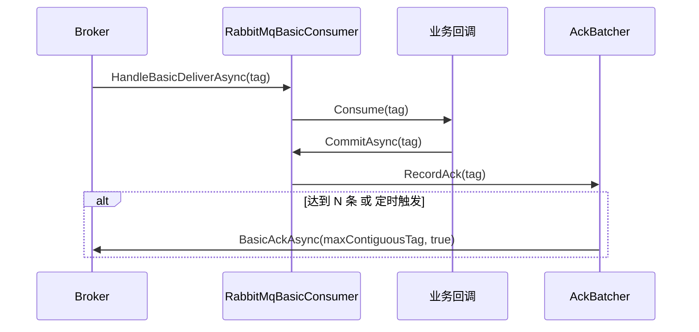

## 用户需求

对 H.ToolBox.RabbitMQ 进行下一版本迭代优化，覆盖此前识别的 P0 / P1 / P2 全部项，在不重新引入 PublishConfirmsTracker 的前提下提升消费 ACK 吞吐、修正并发语义、清理死代码并收敛连接创建竞态。

## 产品概述

本次迭代聚焦 RabbitMQ 消费侧的确认（ACK）效率与健壮性：将逐条 ACK 改为「累积批量确认」，并提供可取消的确认令牌、并发完成顺序下的连续区间语义、以及若干代码整洁修复，整体提升高吞吐场景下的 ACK 能力（目标万级/s）。

## 核心特性

- 批量 ACK（累积确认）：新增 AckBatcher，维护「已确认连续 deliveryTag 区间」，达到 N 条或定时（如每 10ms）任一条件即发送 `BasicAckAsync(maxTag, true)`，网络帧减少 1~2 个数量级。
- 并发完成顺序安全：在 ConsumerConcurrent>1 的乱序完成场景下，依据完成顺序补齐连续区间，避免 `multiple:true` 误确认未处理消息。
- 可取消的 ACK/Reject：确认与拒绝操作传入关联的 CancellationToken，避免 broker flow control 时无限阻塞回调线程。
- 死代码清理：移除 RabbitMqTransport 中永不执行的 PublishConfirms 死代码（confirmTask）。
- 连接创建竞态收敛：修复 ConnectionChannelPool.GetConnectionAsync 首次并发可能重复建连的竞态。
- 配置化批量参数：通过 ListeningOptions / RabbitMQConsumerAttribute 暴露 AckBatchSize 与 AckFlushIntervalMs，声明式与命令式消费均生效。
- 测试保持全绿：补充 AckBatcher 单测（连续性、N 条触发、定时触发、Reject 先 flush），既有 89 项测试不受影响。

## 技术栈

- 语言/框架：C# / .NET（项目多目标 net6.0 与 net10.0），RabbitMQ.Client（IChannel 异步 API）
- 测试：xUnit（既有 H.ToolBox.RabbitMQ.Tests）
- 架构：沿用现有分层（Consumer / Channel / Transport / Model），不引入新架构模式

## 实现方案

### 总体策略

新增独立、可复用的 `AckBatcher` 组件，封装「连续区间累积确认 + 混合触发（N 条或定时）」语义；`RabbitMqBasicConsumer`（声明式消费主路径）与 `ConsumerService`（命令式消费路径）均接入该组件，统一 ACK 行为。并发乱序完成通过「nextToAck 游标 + 已完成但未连续集合」保证 `multiple:true` 仅确认真正处理完成的连续前缀。

### 关键技术决策

1. **连续区间追踪**：deliveryTag 在同一 channel 上严格单调递增。维护游标 `_nextToAck`（下一个尚未确认的最小 tag）与 `SortedSet<ulong> _pending`（已完成但破坏连续的 tag）。完成某 tag 时：若等于 `_nextToAck` 则向后推进直至断点；否则加入 `_pending`。Flush 时发送 `BasicAckAsync(_nextToAck - 1, multiple:true)`，一次性确认 1..(_nextToAck-1)。
2. **混合触发（N 条或定时取先到）**：每次记录后若已完成待确认数 >= `AckBatchSize` 立即 flush；同时内部 `Timer`（间隔 `AckFlushIntervalMs`）兜底低吞吐场景，避免尾批长时间不确认。Timer 回调与完成线程共用同一把锁，串行化 AMQP 发送。
3. **Reject 语义**：拒绝某 tag 前先 flush 连续 ACK（确认其之前的所有完成项），再 `BasicRejectAsync(tag, requeue, multiple:false)`，避免将待拒绝消息一并 `multiple` 确认。
4. **可取消令牌**：`RabbitMqBasicConsumer` 构造新增 `CancellationToken`；`RabbitMqConsumerClient.ListeningAsync` 将现有 `cancellationToken` 透传；`ConsumerService` 中现有 `CancellationToken.None` 全部替换为作用域内的 `cancellationToken`。
5. **关闭/释放兜底**：通道关闭（`HandleChannelShutdownAsync`）与 consumer 释放时调用 `AckBatcher.Flush()` 后再停 Timer，确保已处理消息被确认（未处理项由 broker 在通道关闭后重投，符合 at-least-once 语义）。
6. **死代码清理**：删除 `RabbitMqTransport.SendAsync` 第 101 行 `confirmTask` 声明及 146-153 行 `if (confirmTask != null)` 整段，同步更新方法注释。
7. **连接竞态收敛**：`GetConnectionAsync` 引入「在途连接任务」去重（`Task<IConnection>? _connectingTask` + lock），保证首次并发仅创建一个连接，其余直接复用，避免重复建连再 Dispose。

### 性能与可靠性

- 批量 ACK 将万级/s 下的 AMQP 确认帧数量降低 1~2 个数量级，是相对独立连接修复后最直接的吞吐收益点。
- AckBatcher 的内存开销为 `SortedSet`（pending 数量 <= PrefetchCount），可控；锁粒度仅覆盖元数据变更与发送，不阻塞业务处理。
- 定时 flush 仅产生低频率心跳级帧（每 10ms 一次，且仅在有未确认项时发送），无空转开销。
- 向后兼容：默认 `AckBatchSize=100`、`AckFlushIntervalMs=10`；设为 0/<=0 时退化为逐条确认，便于灰度。

## 实现备注

- 复用现有 `IChannel` 异步 API 与 `ConfigureAwait(false)` 约定，保持与项目一致的异步风格。
- ACK 发送统一在 AckBatcher 内部加锁串行化，避免与 RabbitMQ.Client 并发发送边界冲突。
- 不改动 `RabbitMqBasicConsumer.HandleBasicDeliverAsync` 的 `Task.Run` 并发结构（已由 QoS/PrefetchCount 限流），仅将「完成后的确认」改为入队批处理。
- 日志沿用现有 `ILogger`，flush 失败仅 Warn，不抛出以避免淹没消费循环。

## 架构设计

### 批量 ACK 数据流（声明式主路径）



## 目录结构

```
H.ToolBox.RabbitMQ/
├── Consumer/
│   ├── AckBatcher.cs                 # [NEW] 批量累积确认组件。维护 _nextToAck 游标与 _pending 集合；
│   │                                  #       提供 RecordAck/RecordReject/Flush/Dispose；混合触发（N 条或定时）；
│   │                                  #       内部 lock 串行化 AMQP 发送；Reject 前先 flush 连续 ACK。
│   ├── RabbitMqBasicConsumer.cs      # [MODIFY] 持有 AckBatcher；BasicAck 改为入队批处理、BasicReject 先 flush；
│   │                                  #         构造新增 CancellationToken 并透传给 Batcher；
│   │                                  #         通道关闭/释放时 Flush 并停 Timer。
│   └── RabbitMqConsumerClient.cs     # [MODIFY] ListeningAsync 将 cancellationToken 与 AckBatchSize/AckFlushIntervalMs
│   │                                  #         透传给 RabbitMqBasicConsumer 构造。
├── Consumer/
│   └── ConsumerService.cs            # [MODIFY] ListenAsync / ListenByExchangeAsync 接入 AckBatcher（绑定各自 channel）；
│   │                                  #         所有 CancellationToken.None 替换为作用域内 cancellationToken；
│   │                                  #         新增可选 ackBatchSize/ackFlushIntervalMs 参数（默认 100/10）。
├── Model/
│   ├── ListeningOptions.cs           # [MODIFY] 新增 AckBatchSize(int=100)、AckFlushIntervalMs(int=10)。
│   └── (RabbitMQConsumerAttribute.cs 在根目录)
├── RabbitMQConsumerAttribute.cs      # [MODIFY] 新增 AckBatchSize、AckFlushIntervalMs 属性（默认 100/10），供声明式消费配置。
├── Channel/
│   └── ConnectionChannelPool.cs      # [MODIFY] GetConnectionAsync 增加在途连接任务去重，消除首次并发重复建连竞态。
├── Transport/
│   └── RabbitMqTransport.cs          # [MODIFY] 删除 confirmTask 死代码（声明与 if 块）及对应注释。
└── Consumer/
    └── RabbitConsumerRegister.cs     # [MODIFY] ExecuteAsync 构造 ListeningOptions 时透传 attr.AckBatchSize / AckFlushIntervalMs。

H.ToolBox.RabbitMQ.Tests/
└── Consumer/
    └── AckBatcherTests.cs            # [NEW] AckBatcher 单测：连续完成全确认、乱序补全连续区间、
    │                                  #       达到 N 条触发、定时触发、Reject 先 flush、Dispose 兜底 flush。
    ├── RabbitMqBasicConsumerTests.cs # [MODIFY] 适配 BasicAck 改为批处理（验证最终 cumulative ack 调用）。
    └── RabbitMqConsumerClientTests.cs# [MODIFY] 适配构造签名变化（传入 CancellationToken / ack 参数）。
```

## 关键代码结构

```
namespace H.ToolBox.RabbitMQ.Consumer
{
    /// <summary>批量累积确认器：维护连续 deliveryTag 区间，达到批次或定时阈值时发送 multiple:true 确认。</summary>
    internal sealed class AckBatcher : IDisposable
    {
        public AckBatcher(IChannel channel, int batchSize, TimeSpan flushInterval, CancellationToken token);
        /// <summary>记录一条已成功处理的消息，触发批量确认判断。</summary>
        public void RecordAck(ulong deliveryTag);
        /// <summary>拒绝指定消息：先 flush 连续 ACK，再单独拒绝（multiple:false）。</summary>
        public void RecordReject(ulong deliveryTag, bool requeue);
        /// <summary>立即发送当前连续区间的累积确认。</summary>
        public void Flush();
        public void Dispose();
    }
}
```
